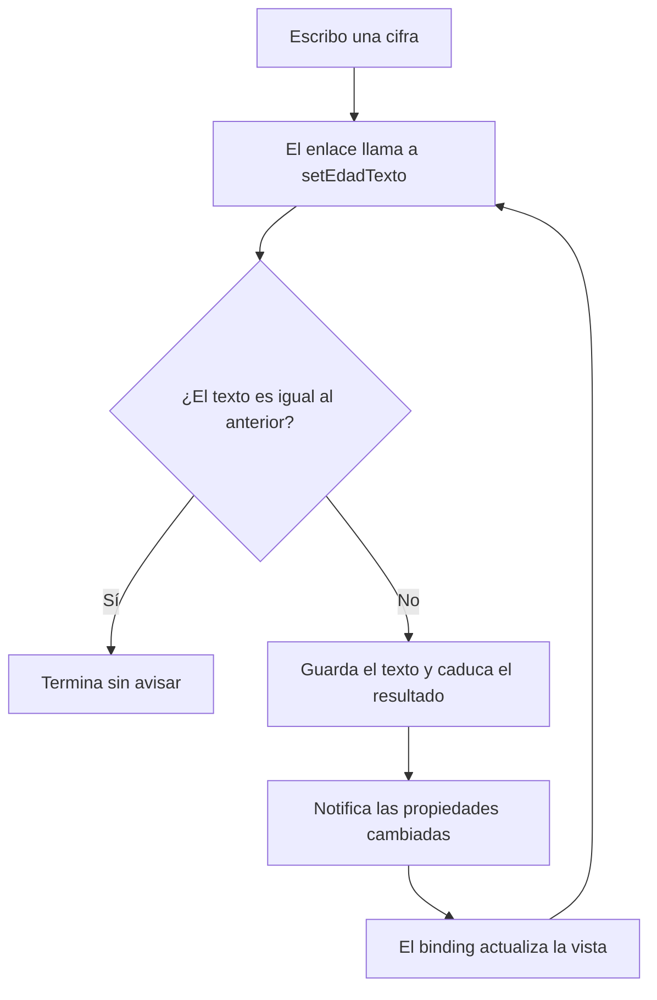

La versión de esta entrega se explica en [EdadCaninaMVC](#edadcaninamvc)

# 🐶 EdadCanina · v1

Aplicación Android (Java) que calcula la edad "humana" de un perro multiplicando su edad por 7.

Esta es la **versión 1**: funciona, pero no comprueba lo que escribe el usuario. Tu tarea es convertirla en la **versión 2** (rama `v2-validacion`), que valida la entrada y controla los errores sin que la app se cierre.

---

## Objetivos

Al terminar sabrás:

- Detectar por qué una app se cierra (`NumberFormatException`) y evitarlo con `try/catch`.
- Validar datos de entrada: campo vacío, texto no numérico y rango de valores.
- Mostrar errores al usuario con `EditText.setError()`.
- Sustituir "números mágicos" por constantes.
- Llevar los textos a `strings.xml` y usar formatos con varios parámetros.
- Trabajar en una rama de Git distinta de `main`.

---

## Paso 0 · Prepara el proyecto

1. Haz un **fork** de este repositorio (botón *Fork*) y clona tu fork:
   ```bash
   git clone https://github.com/TU_USUARIO/edadCaninav1.git
   ```
2. Ábrelo en Android Studio y ejecútalo en el emulador.

## Paso 1 · Rompe la app (a propósito)

Antes de arreglar nada, comprueba qué falla. Prueba estas entradas y anota qué pasa:

| Entrada | ¿Qué ocurre? |
|---|---|
| *(campo vacío)* | |
| `abc` | |
| `3.5` | |
| `0` | |
| `-4` | |
| `99999999999` | |
| `400000000` | |

> 💡 Cuando la app se cierre, abre el **Logcat** y busca la excepción. ¿Qué método la lanza? ¿Por qué el último caso no cierra la app pero da un resultado absurdo?

## Paso 2 · Crea la rama de trabajo

```bash
git checkout -b v2-validacion
```

Todo lo que hagas a partir de aquí irá en esta rama; `main` se queda como está.

## Paso 3 · Corrige los fallos que ya trae la v1

Antes de añadir nada nuevo, limpia lo que hay:

1. **`activity_main.xml`**: busca la etiqueta de cierre `</TextView>>` y quita el `>` que sobra.
2. **`strings.xml`**: en `tu_edad_format` hay una falta de ortografía ("fuero"). Corrígela.
3. **Texto escrito "a fuego"**: el `android:hint="Ejemplo: 6"` del `EditText` está directamente en el layout. Llévalo a `strings.xml` con el nombre `hint_edad` y úsalo con `@string/hint_edad`.
   > 💡 Android Studio marca este aviso en amarillo (*Hardcoded string*). Prueba `Alt + Enter` encima.
4. **`MainActivity.java`**: hay tres `import` que no se usan (`Insets`, `ViewCompat`, `WindowInsetsCompat`). Elimínalos (`Ctrl + Alt + O`).

## Paso 4 · Añade los mensajes de error

En `res/values/strings.xml` añade tres textos nuevos:

```xml
<string name="error_vacio">Introduce la edad de tu perro</string>
<string name="error_no_numero">Introduce un número entero válido</string>
<string name="error_rango">La edad debe estar entre %1$d y %2$d años</string>
```

> ❓ ¿Qué significan `%1$d` y `%2$d`? ¿En qué orden se rellenan?

## Paso 5 · Restringe la entrada desde el layout

En el `EditText` (`@+id/age_input`) añade:

```xml
android:inputType="number"
android:maxLength="2"
android:gravity="center"
android:importantForAutofill="no"
```

| Atributo | Para qué sirve |
|---|---|
| `inputType="number"` | Muestra el teclado numérico: sin letras, sin signo menos ni decimales. |
| `maxLength="2"` | No deja escribir más de 2 cifras. |
| `gravity="center"` | Centra el número en el campo. |
| `importantForAutofill="no"` | Evita que el sistema ofrezca autocompletar. |

> ⚠️ Esto **no sustituye** a la validación en Java: el campo puede quedarse vacío y nunca conviene fiarse solo de la interfaz. Por eso seguimos con el código.

## Paso 6 · Sustituye los números mágicos por constantes

Al principio de la clase `MainActivity` declara:

```java
private static final int FACTOR_CANINO = 7;
private static final int EDAD_MINIMA = 1;
private static final int EDAD_MAXIMA = 30; // ningún perro supera esta edad
```

y usa `FACTOR_CANINO` en lugar del `7`.

## Paso 7 · Convierte las vistas en atributos de la clase

Ahora `ageEdit` y `resultText` son variables locales de `onCreate()`. Como vas a usarlas desde otros métodos, decláralas como atributos:

```java
private EditText ageEdit;
private TextView resultText;
```

y en `onCreate()` asígnalas **sin volver a escribir el tipo**:

```java
ageEdit = findViewById(R.id.age_input);
resultText = findViewById(R.id.result_text);
```

> ❓ ¿Qué pasaría si dejaras `EditText ageEdit = findViewById(...)` dentro de `onCreate()`?

## Paso 8 · Saca la lógica del botón a un método

El `setOnClickListener` debe quedar así de corto:

```java
button1.setOnClickListener(view -> calcularEdad());
```

Toda la lógica pasa a un método nuevo: `private void calcularEdad()`.

## Paso 9 · Crea un método para mostrar errores

```java
private void mostrarError(String mensaje) {
    // 1. Mostrar el mensaje en el EditText (setError)
    // 2. Poner el foco en el EditText (requestFocus)
    // 3. Borrar el resultado anterior del TextView
}
```

## Paso 10 · Valida la entrada en `calcularEdad()`

Implementa el método siguiendo este orden. En cuanto algo falle, llama a `mostrarError(...)` y sal con `return`:

1. **Leer** el texto del `EditText` quitando espacios (`trim()`).
2. **¿Está vacío?** → `error_vacio`. Recuerda que `Integer.parseInt("")` lanza `NumberFormatException`.
3. **Convertir a `int`** dentro de un `try/catch (NumberFormatException e)` → si falla, `error_no_numero`.
4. **¿Está en rango?** Si `age < EDAD_MINIMA || age > EDAD_MAXIMA` → `error_rango`. Para rellenar `%1$d` y `%2$d`:
   ```java
   getString(R.string.error_rango, EDAD_MINIMA, EDAD_MAXIMA)
   ```
5. **Todo correcto**: quita el error del campo (`setError(null)`), calcula `age * FACTOR_CANINO` y muestra el resultado con `tu_edad_format`.

> ❓ ¿Por qué limitar la edad a 30 evita también el desbordamiento que viste en el Paso 1?

## Paso 11 · Vuelve a probar

Comprueba que **la app nunca se cierra**:

| Entrada | Resultado esperado |
|---|---|
| *(vacío)* | Error: "Introduce la edad de tu perro" |
| `0` | Error: "La edad debe estar entre 1 y 30 años" |
| `31` | Error de rango |
| `1` | "Si tu perro fuera humano tendría 7 años" |
| `30` | "Si tu perro fuera humano tendría 210 años" |

> 💡 Con el teclado numérico no puedes escribir `abc` ni `-4`. ¿Cómo comprobarías que el `try/catch` funciona? (Pista: quita `inputType` un momento.)

## Paso 12 · Guarda y sube tu trabajo

```bash
git add .
git commit -m "Validación de la entrada y control de errores aritméticos"
git push -u origin v2-validacion
```

Comprueba en GitHub que tu fork tiene ahora dos ramas: `main` y `v2-validacion`.

---

## ✅ Lista de comprobación

- [ ] La app no se cierra con ninguna entrada.
- [ ] Todos los textos están en `strings.xml` (ningún aviso *Hardcoded string*).
- [ ] No quedan números mágicos en `MainActivity`.
- [ ] `onCreate()` solo prepara la pantalla; la lógica está en `calcularEdad()`.
- [ ] El trabajo está en la rama `v2-validacion`, no en `main`.

## EdadCaninaMVC

Versión de la actividad de DataBinding y MVC, en la rama `v3-mvc`, a partir de `v2-validacion`. Mantiene la conversión y la validación de la v2 y añade el botón Limpiar

El `applicationId` es `es.davante.edadcanina.mvc`, distinto del de la v2. El `namespace` sigue siendo `es.davante.edadcanina`, que es el paquete de las clases Java y de las clases generadas `R` y `BR`

### Organización y funcionamiento

| Pieza | Archivo o paquete | Responsabilidad |
|---|---|---|
| Modelo | `modelo/EdadCaninaModelo.java` y `modelo/Validacion.java` | Guarda la entrada, valida, calcula y avisa de los cambios |
| Vista | `res/layout/activity_main.xml` y `vista/AdaptadoresVista.java` | Muestra datos y errores, recoge la entrada y envía los clics |
| Controlador | `controlador/EdadCaninaControlador.java` | Da al modelo las órdenes de calcular y limpiar |
| Activity | `MainActivity.java` | Crea y conecta las piezas, guarda y reconstruye el estado |

La edad válida está entre 1 y 30. El modelo elimina los espacios exteriores y distingue vacío, texto que no es un entero y edad fuera de rango. Un valor que no cabe en `int` se controla con `NumberFormatException`. La multiplicación solo se realiza después de validar el rango, así que el resultado máximo es 210

Al editar la entrada, el resultado anterior caduca y se borra el error. Los setters de edad humana y validación son privados. Cada setter comprueba si el valor ha cambiado antes de avisar. Limpiar deja la entrada vacía, la edad humana a cero y la validación en `SIN_CALCULAR`, incluso si ya había un error de campo vacío

Los botones están uno al lado del otro y comparten el ancho con `layout_weight`. El contenido puede desplazarse cuando la pantalla está en horizontal para que los controles sigan accesibles. Los mensajes están en `strings.xml`, con parámetros de formato, y no en el modelo

### Reto elegido: casos raros

He decidido aceptar `05` y `+5` como el entero 5. Ambos producen 35 años humanos porque el cero inicial y el signo positivo no cambian el valor. `Integer.parseInt` ya reconoce los dos formatos, así que no hace falta añadir otra conversión

Las pruebas `ceroInicialEsValido` y `signoPositivoEsValido` comprueban esta decisión directamente en el modelo. El campo conserva el teclado numérico y el límite de dos caracteres de la v2. Estas restricciones ayudan a introducir datos, pero no sustituyen a la validación Java

### Preguntas Piensa

**Paso 1. ¿Ha aparecido ya alguna clase nueva? ¿Por qué?**

Activar DataBinding prepara el proyecto, pero todavía no crea `ActivityMainBinding`. Hace falta que el XML tenga la raíz `<layout>` y volver a compilar para generar el enlace de esa pantalla

**Paso 2. Si escribo mal un id, ¿cuándo me entero con binding y con `findViewById`?**

Si escribo mal `binding.ageInput`, Java detecta al compilar que ese campo no existe. Con `findViewById`, un nombre de recurso inexistente también falla al compilar, pero un id válido de otra pantalla puede devolver `null` en ejecución. Un tipo incorrecto puede provocar una conversión inválida. El binding evita esas búsquedas y proporciona las vistas con sus tipos

La clase generada se ha revisado después de compilar. `activity_main.xml` produce `ActivityMainBinding`, y `age_input` se convierte en el campo `ageInput`. También aparecen los campos de los botones y del resultado, y un setter por cada variable del bloque `<data>`

**Paso 3. Si la app pasa a inglés, ¿hay que tocar el modelo?**

No. El modelo devuelve una edad numérica y un valor de `Validacion`, sin textos para el usuario ni recursos de Android. La traducción se añade en `res/values-en/strings.xml`. La vista obtiene los mensajes de los recursos, por lo que las reglas y sus pruebas no cambian

**Paso 4. ¿Dónde se corta la cadena del enlace bidireccional?**

Al escribir una cifra, el enlace llama a `setEdadTexto`. Si el texto cambia, el modelo lo guarda, invalida el resultado y avisa. El binding recibe el aviso y actualiza las expresiones que dependen de ese dato. Si vuelve a llegar el mismo texto, el `if` de igualdad termina el setter sin emitir otro aviso ni invalidar otra vez el resultado



El resultado utiliza `INVISIBLE` para conservar su hueco y mantener los botones en su sitio. Con `GONE`, el espacio se elimina y los controles inferiores suben. El XML aplica el formato del recurso y decide la visibilidad, pero no multiplica ni valida edades

**Paso 5. ¿Por qué el adaptador está en vista y no en modelo?**

Porque traduce un estado a un mensaje localizado, llama a `setError` y gestiona el foco del campo. Son decisiones de presentación que dependen de Android. El modelo solo decide si el dato es válido. Al cambiar la entrada, el estado pasa a `SIN_CALCULAR`, el binding llama al adaptador y este quita el error con `null`

**Paso 6. ¿Es buena señal que el controlador tenga pocas líneas?**

Sí. Cada método representa una acción y da una orden al modelo. No necesita leer vistas, convertir números ni elegir mensajes. Si empezara a validar edades o a modificar un `EditText`, estaría haciendo trabajo del modelo o de la vista

**Paso 7. ¿Dónde podría vivir el modelo para no morir al girar?**

En un `ViewModel` asociado a la Activity, que sobrevive a los cambios de configuración. En esta actividad se mantiene MVC, por lo que el modelo se reconstruye desde `onSaveInstanceState`. Un `ViewModel` por sí solo tampoco conserva datos si el proceso desaparece, para ese caso se necesita un mecanismo de estado guardado o almacenamiento

### Experimento y conservación del estado

En la versión etiquetada `paso-6`, sin guardado de estado, se calculó la edad para 6 y se comprobó que al recrear la Activity se perdían tanto el texto de entrada como el resultado, porque el modelo nuevo estaba vacío. La prueba de recreación está en esa etiqueta. El giro a horizontal se comprobó también sobre esa versión y produjo la misma pérdida

El paso 7 guarda solo el texto y un booleano que indica si se había intentado calcular. No guarda ni la edad calculada ni mensajes ni el enum completo. Al reconstruir, restaura el texto y repite `calcular()` solo si hubo un intento previo. Así recupera un resultado o un error y conserva también una entrada pendiente sin calcularla por su cuenta

Las claves del `Bundle` son constantes y la restauración se hace antes de entregar el modelo al binding. Las pruebas finales comprueban recreación, giro a horizontal y cambio entre modo oscuro y claro

### Explícalo con tus palabras

**1. ¿Qué diferencia hay entre `@{...}` y `@={...}`?**

`@{...}` permite que la vista lea del modelo. Lo uso para el texto del resultado, su visibilidad y el error. `@={...}` enlaza en los dos sentidos. Además de mostrar el texto del modelo, envía al modelo lo que escribo en el campo. Por eso la entrada puede actualizarse sin leer `getText()` desde la Activity

**2. ¿Qué ocurre desde que pulso Calcular hasta que aparece 42?**

Primero escribo 6 y el enlace bidireccional lo lleva a `setEdadTexto`. Al pulsar Calcular, la lambda del XML llama a `onCalcularClick` del controlador. Este pide `calcular()` al modelo. El modelo comprueba que no esté vacío, convierte el entero, valida que esté entre 1 y 30 y lo multiplica por `FACTOR_CANINO`

La edad humana pasa a 42 y la validación a `OK`. Los setters avisan con `BR.edadHumana` y `BR.validacion` cuando esos valores cambian. DataBinding actualiza el texto con `tu_edad_format`, hace visible el resultado y el adaptador quita cualquier error. La Activity no escribe el resultado ni atiende el clic

**3. ¿Qué cambiaría para que el factor fuera 6 en vez de 7 y por qué solo toco un fichero?**

Cambiaría `FACTOR_CANINO` de 7 a 6 en `EdadCaninaModelo.java`. La operación solo está definida allí. La vista recibe el resultado y el controlador da la orden, de modo que no necesitan conocer el factor. Al hacer ese cambio habría que actualizar también las expectativas numéricas de las pruebas, porque 6 pasaría a producir 36. El único fichero de producción que cambia es el modelo

### Pruebas y ejecución

Desde la raíz del proyecto, con el JDK de Android Studio y un emulador iniciado:

```powershell
.\gradlew.bat :app:assembleDebug :app:testDebugUnitTest :app:connectedDebugAndroidTest :app:lintDebug
.\gradlew.bat :app:installDebug
```

Las pruebas JUnit están en `app/src/test`. Hay 23 del modelo y 5 del controlador, además de la prueba de ejemplo que ya tenía el proyecto. Cubren valores correctos, límites, errores, espacios, desbordamiento de entrada, caducidad, avisos de propiedades y limpieza

Las pruebas de Android están en `app/src/androidTest`. Comprueban la pantalla con Espresso. Para probar `abc`, retiran los filtros únicamente durante esa prueba, sin cambiar las restricciones del layout de la app

| Comprobación | Resultado esperado |
|---|---|
| `6`, `1` y `30` | 42, 7 y 210 años humanos |
| Vacío, `abc`, `0` y `31` | Mensaje correspondiente sin cierre de la app |
| Editar después de calcular | El resultado queda invisible |
| Editar después de un error | El error desaparece sin pulsar Calcular |
| Limpiar tras resultado o error | Entrada vacía, sin resultado y sin error |
| Recrear tras calcular o fallar | Conserva resultado o error |
| Recrear con una entrada pendiente | Conserva el texto sin calcularlo |
| Girar a horizontal | Conserva resultado o error y permite acceder a los botones |
| Cambiar entre modo oscuro y claro | Conserva resultado o error |

Verificación final en el emulador Pixel 7 con Android 17: compilación correcta, 29 pruebas JUnit y 20 pruebas de Android en verde, sin fallos ni pruebas omitidas

| Paso | Pruebas JUnit aprobadas | Pruebas de Android aprobadas |
|---|---:|---:|
| 1 | 1 | 8 |
| 2 | 1 | 8 |
| 3 | 20 | 8 |
| 4 | 24 | 9 |
| 5 | 24 | 10 |
| 6 | 29 | 12 |
| 7 | 29 | 20 |

La compilación Java no muestra avisos. Lint termina con 0 errores y 1 aviso que recomienda actualizar el complemento de Android para Gradle de 9.4.1 a 9.5.1. Se mantiene la versión que ya utiliza el proyecto para no añadir una actualización de herramientas a la actividad. Durante las pruebas, el JDK también muestra un aviso de obsolescencia de una dependencia Protobuf del ejecutor de Android, sin impedir su ejecución

### Autoevaluación

- [x] La app calcula y valida vacío, texto, 0 y 31 sin cerrarse en las pruebas
- [x] MainActivity solo conecta las piezas y guarda o reconstruye el estado
- [x] No hay `findViewById`, `setText`, `setError` ni `setOnClickListener` en MainActivity
- [x] El modelo no importa `android.*` ni contiene textos para el usuario
- [x] El modelo usa `BaseObservable`, tres getters `@Bindable` y avisos solo cuando cambia el valor
- [x] Los setters de resultado y validación son privados, y editar invalida el cálculo anterior
- [x] La entrada usa `@={}`, el resultado usa `@{}` y los errores pasan por un adaptador propio de vista
- [x] El controlador solo conserva el modelo, sin referencias a vistas
- [x] Calcular y Limpiar se enlazan con lambdas en el XML
- [x] El resultado y los errores sobreviven a los cambios de configuración comprobados
- [x] Hay más de cinco pruebas JUnit en verde, incluidas las del controlador
- [x] Los comentarios explican las decisiones y el motivo de las comprobaciones
- [x] Se ha realizado el reto de casos raros y se han respondido las preguntas de la guía
- [x] Cada paso tiene su commit y etiqueta `paso-1` a `paso-7`

### Historial y entrega

Los siete commits usan el prefijo `Paso N:` y las etiquetas están en minúsculas. Cada paso se ha compilado y probado antes de guardarlo. Las fechas corresponden al momento real de los commits

```powershell
git log --oneline --decorate v2-validacion..v3-mvc
git tag --list "paso-*"
git push -u origin v3-mvc --tags
```

[Ver la rama de entrega v3-mvc](https://github.com/mgg06/edadCaninav1/tree/v3-mvc)
